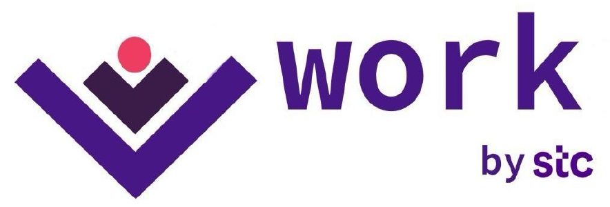
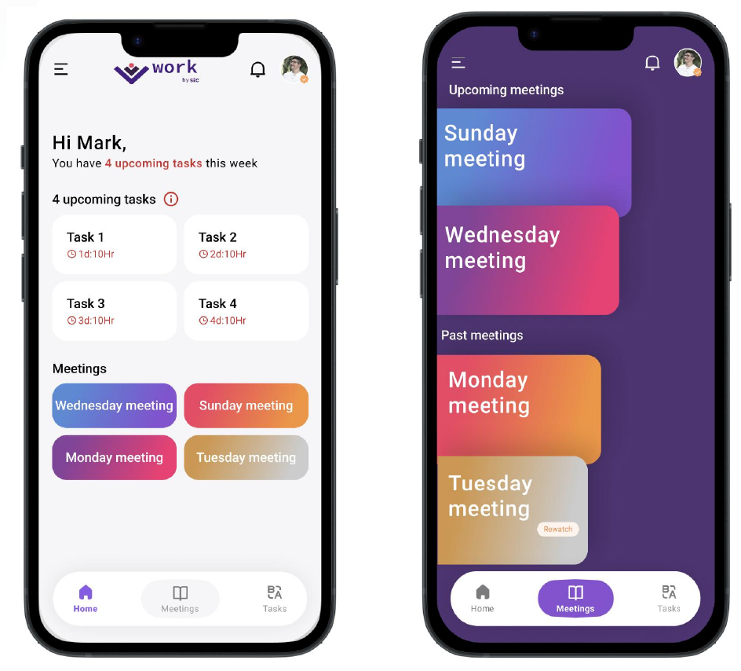
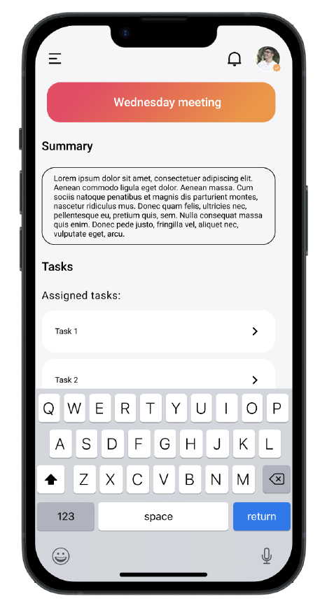

# work by stc: GenAI Workplace Collaboration Concept
### فكرة منصة عمل ذكية مدعومة بالذكاء الاصطناعي التوليدي

👥 **Team project** · 💡 **Product concept** developed for the **stc Challenge** with **Misk Skills (Mohammed Bin Salman Foundation)**

🎤 **Presented to a panel of stc leaders**

👥 **مشروع جماعي** · 💡 **فكرة منتج تقني** قُدّمت في **تحدي stc** ضمن برنامج **مهارات مسك (مؤسسة محمد بن سلمان)**

🎤 **عُرضت أمام لجنة من قياديي stc**

[English](#english) · [العربية](#arabic)

> **Note:** This is a concept proposal created for a challenge. It is not an official stc product, and the repository contains the product idea, UX concept and go-to-market plan rather than an implementation.

---

## The Idea

The idea came from our own daily routine: back-to-back online meetings, calls and lectures, with important decisions and tasks getting lost along the way.

**work by stc** is a proposed telco-backed workplace platform that combines voice and video calls, private and group chats, and task management in one place, with a **generative AI assistant** built into every meeting.

Our team pitched the concept, including the product idea, UX, brand identity and go-to-market plan, **to a panel of stc leaders**.

## Key Capabilities

- 🧠 **AI meeting summaries**: automatically generates a summary and notes at the end of every meeting or call.
- ✅ **Automatic task extraction**: tasks assigned during a meeting are added directly to each person's task list.
- 🌍 **Real-time translation**: live AI-powered multilingual subtitles, including Arabic, for global and remote teams.
- 📅 **Unified workspace**: upcoming and past meetings (with replay) and deadlines in one view.
- 🔒 **Data localization and security**: all data stored within Saudi Arabia for privacy and regulatory compliance.
- 🎓 **Integrated talent development** and **local ecosystem integration**.

## Product Concept

| Home and meetings | Meeting summary and assigned tasks |
|---|---|
|  |  |

## Why stc

The concept builds on stc's position and ecosystem as its main competitive advantage:

- **Comprehensive integration** with the stc group ecosystem, including stc tv, center3, sirar by stc and CCC by stc
- **Data localization** inside the Kingdom
- **Alignment with Saudi Vision 2030** and digital transformation goals
- **Trusted national brand**

## Target Audience

Global and remote teams · Saudi businesses · Multinational corporations · Hybrid workforces · Universities

## Brand Identity

The logo was designed around the letter **W**: the first stroke represents the work environment, the second represents tasks, and the dot represents flexibility, simplicity, and audio and visual communication.

**Slogan:** *"Empower Your Team, Elevate Your Work with stc work."* · «مَكِّن فريقك وأنجز مهامك بذكاء مع stc work!»

## Go-to-Market Strategy

| Area | Plan |
|---|---|
| **Objective** | Position the platform as the leading AI-powered collaboration platform for Saudi businesses and global teams |
| **Key messages** | Data security and compliance · Arabic and cultural localization · AI-driven productivity |
| **Channels** | Social media ads, content marketing and email campaigns · partnerships with government, educational institutions and local businesses · webinars and industry events |
| **Promotions** | Free trials and demos · referral program · customer testimonials |
| **Success metrics** | Engagement, trial conversion and customer feedback |

📄 Full concept in the [presentation](docs/work_by_stc_presentation.pdf).

---

## الفكرة

انطلقت الفكرة من واقعنا اليومي: اجتماعات ومكالمات ومحاضرات عن بُعد متتالية، تضيع بينها القرارات والمهام المهمة.

**work by stc** منصة عمل مقترحة مدعومة من شركة اتصالات، تجمع المكالمات الصوتية والمرئية، والمحادثات الخاصة والجماعية، وإدارة المهام في مكان واحد، مع **مساعد ذكي مبني على الذكاء الاصطناعي التوليدي** داخل كل اجتماع.

وقدّم فريقنا الفكرة، بما فيها تصميم المنتج والهوية البصرية والخطة التسويقية، **أمام لجنة من قياديي stc**.

## أبرز الخصائص

- 🧠 **ملخصات ذكية للاجتماعات**: توليد ملخص وملاحظات تلقائياً في نهاية كل اجتماع أو مكالمة.
- ✅ **استخراج المهام تلقائياً**: المهام المسندة أثناء الاجتماع تُضاف مباشرة إلى قائمة مهام كل شخص.
- 🌍 **ترجمة فورية**: ترجمة مباشرة متعددة اللغات، منها العربية، للفرق العالمية والعاملة عن بُعد.
- 📅 **مساحة عمل موحّدة**: الاجتماعات القادمة والسابقة مع إمكانية إعادة المشاهدة، والمواعيد النهائية في واجهة واحدة.
- 🔒 **توطين البيانات وأمنها**: حفظ جميع البيانات داخل المملكة لضمان الخصوصية والامتثال للأنظمة.
- 🎓 **تطوير المواهب** و**التكامل مع المنظومة المحلية**.

## لماذا stc

- **تكامل شامل** مع منظومة مجموعة stc
- **توطين البيانات** داخل المملكة
- **الانسجام مع رؤية المملكة 2030** وأهداف التحول الرقمي
- **علامة وطنية موثوقة**

## الفئات المستهدفة

الفرق العالمية والعاملة عن بُعد · الشركات السعودية · الشركات متعددة الجنسيات · بيئات العمل الهجين · الجامعات

## الهوية البصرية

صُمّم الشعار حول حرف **W**: الجزء الأول يمثل بيئة العمل، والثاني يمثل المهام، والنقطة ترمز إلى المرونة والسهولة والتواصل الصوتي والمرئي.

**الشعار التسويقي:** «مَكِّن فريقك وأنجز مهامك بذكاء مع stc work!»

## الخطة التسويقية

استراتيجية متكاملة تشمل: الرسائل الرئيسية (أمن البيانات، والتوطين، ورفع الإنتاجية)، والقنوات الرقمية والشراكات والفعاليات، والعروض الترويجية (التجربة المجانية وبرنامج الإحالة)، ومؤشرات قياس النجاح.

> **ملاحظة:** هذه فكرة منتج قُدّمت ضمن تحدٍّ، وليست منتجاً رسمياً من stc.

📄 التفاصيل الكاملة في [العرض التقديمي](docs/work_by_stc_presentation.pdf).

